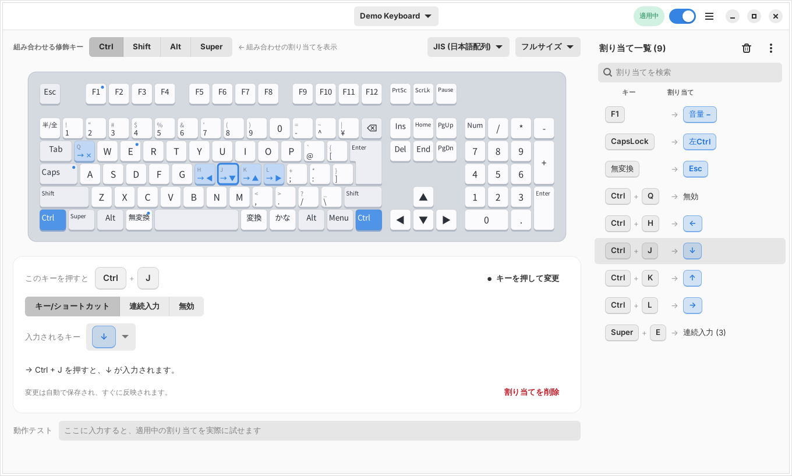

# Keyboard Remapper

[English](README.md) · バージョン 1.0.0 · [変更履歴](CHANGELOG.md)

Linux 向けのキーボード割り当てツール(GTK4 + libadwaita)。
接続中のキーボードを実物に近い見た目で描画し、**キーをクリック/実際に押す → 何を入力させるか選ぶ**
だけで、キーや「Ctrl + J」のような組み合わせの割り当てを確認・変更できます。



## 特長

- **ショートカットの再登録によるカクつきがありません。**
  input-remapper 2 は「割り当てたキー」と「そのまま通すキー」を別々の仮想デバイスから出すため、
  修飾キー → 通常キー(逆順も)を押すたびに入力元が切り替わり、X/Wayland のデスクトップが
  全ショートカットを登録し直して一瞬固まります。Keyboard Remapper は **すべての出力を、起動時に一度だけ作る
  1 つの仮想キーボードから出す**ので、この切り替えが起きません(自動テストで検証)。
- ANSI / ISO / **JIS** 配列、フルサイズ / テンキーレス。日本語キー(半角/全角・無変換・変換・かな)に対応。
- **Apple のキーボード (Magic Keyboard など)**: 配列 (テンキーの有無、US / ISO / JIS) を機種 ID から自動で選び、
  **Fn をレイヤーキーとして使えます** (`Fn + H → ←`)。右上のキーは、イジェクト (2015 年版) とロック (それ以降) を同じキーとして扱います。
  配列にないキーは「その他のキー」欄に出ます。
- 修飾キーを押しながら(または画面の Ctrl / Shift / Alt / Super を選んで)キーボードを見ると、
  その組み合わせの割り当てが各キーに表示されます。
- 割り当ての種類: キー/ショートカット、連続入力(待機つき)、無効化。
- 「押して指定」: 実際にキーを押して、トリガーや出力を設定。Super など DE に奪われるキーも
  記録中は排他取得して確実に取れます。
- **割り当て一覧**: 行をドラッグして並べ替え、または見出し (キー / 割り当て) をクリックして昇順 → 降順 → 手動順に切り替え。
  行を右クリックで即削除 (確認なし、「元に戻す」付き)、ゴミ箱ボタンで全削除。
  一覧横のメニューから、割り当ての**書き出し / 読み込み**もできます (共有や別の PC への移行に)。
- 変更は自動保存・即時反映。削除は「元に戻す」可能。ライト/ダーク、日本語/英語、狭い画面にも対応。

## 動作環境 / インストール

GTK 4 (4.6 以上)・libadwaita 1.0 以上・Python 3.10 以上が必要です (**Ubuntu 22.04** 以降、Debian 12、Fedora 36 以降)。Debian / Ubuntu 系の例:

```sh
sudo apt install python3 python3-evdev python3-gi python3-gi-cairo gir1.2-gtk-4.0 gir1.2-adw-1
sudo ./install.sh                      # /usr/local にインストール
sudo systemctl enable --now keyboard-remapperd
keyboard-remapper                           # またはアプリメニューの「Keyboard Remapper」
```

`keyboard-remapper-ctl doctor` でセットアップを診断できます。アンインストールは `sudo ./uninstall.sh`。

### 旧名「Remapper」からの移行

このプロジェクトは以前「Remapper」という名前でした。`sudo ./install.sh` が旧サービス・旧コマンド
(`remapper-daemon`、`remapper-gtk`、`remapper-control`) を削除し、設定は自動で引き継がれます
(`~/.config/remapper` → `~/.config/keyboard-remapper`、`/var/lib/remapper` → `/var/lib/keyboard-remapper`)。
そのあと `sudo systemctl enable --now keyboard-remapperd` を実行してください。

## 仕組み

```
GUI (keyboard-remapper, ユーザー権限) ──JSON/Unixソケット──▶ keyboard-remapperd (root, systemd)
  ~/.config/keyboard-remapper/config.json                         ├ キーボードを排他取得 (EVIOCGRAB)
                                                          ├ Engine: 入力 → 出力の変換
                                                          └ 仮想キーボード 1 台 (uinput)
```

- 割り当ては GUI が `~/.config/keyboard-remapper/config.json` に保存し、デーモンへ送ります。
  デーモンも `/var/lib/keyboard-remapper/state.json` に保持するので、再起動後・再接続後も GUI なしで自動適用されます。
- デーモンのソケットは、root とローカルでアクティブなログインセッションのユーザーだけが使えます。
- 割り当てが無いキーは遅延なく素通しされます。トリガーの修飾キーは、割り当てが発火した時だけ
  出力側から一時的に隠し、次に別のキーが必要とした時に初めて戻します
  (`Ctrl+J → ↓` を連打しても Ctrl の上げ下げは 1 回も発生しません)。
  Super / Alt を隠す時は、単独押しと誤認されないよう無害なキー(F24)を挟みます。
- 組み合わせは「最後に押したキーで発火、それ以外のキーは順不同」です。
- 修飾キーだけのトリガー (例: `左Shift + 左Ctrl → Caps Lock`) は、同時に押して、他のキーを押さずに離したときに発火します
  (押す順番は問いません)。それまで修飾キーは普通に通るので、Ctrl+Shift+T などは今までどおり使えます。

### Apple キーボードの注意

- Linux の `hid-apple` ドライバは Fn を通常のキー (`KEY_FN`) として届けますが、一部の Fn の組み合わせは
  Keyboard Remapper に届く**前に**カーネルが変換します (Fn+← は Fn + Home、Fn+F1 は F1 として届く)。届いたとおりのキーで割り当ててください。
  実際に何が届くかは、ウィンドウを前面にしてキーを押すと画面で確認できます。
- F 列は既定でメディアキーとして動作します。Fn なしで F1〜F12 にするにはカーネルオプション `hid_apple fnmode=2` を使います。
- Bluetooth キーボードはアドレスで区別するので、同じ機種を 2 台つないでも別々に扱えます。

## トラブルシューティング: 「出力したキーが効かない」

どこで止まっているかを順に確認します。端末で `keyboard-remapper-ctl monitor --output` を実行してからキーを押します。

```
IN   046d:c31c  LEFTCTRL           down      <- Keyboard Remapper が受け取った物理キー
OUT              ZENKAKUHANKAKU     down      <- Keyboard Remapper がデスクトップへ送ったキー
```

- `OUT` が出ない: 割り当てが発火していません。GUI でトリガー (左右の修飾キー、レイヤー) を確認してください。
- `OUT` は出るのに何も起きない: Keyboard Remapper は正しく送っており、デスクトップ側がそのキーを無視しています。
  `xev -event keyboard` (X11) または `wev` (Wayland) で確認できます。`NoSymbol` (キーシムなし) と出るキーは無視されます。
- **半角/全角**: `ZENKAKUHANKAKU` を送っても、通常は何も起きません。デスクトップのキー配列表 (xkb) にこのキーコードの
  記号が無いためです。xkb は半角/全角キーを Grave キーの別名として扱う (`<HZTG>` = `<TLDE>`) ので、日本語 (`jp`) 配列では
  `GRAVE` を送ってください。(**物理キー**が何として届くかは機種依存です。多くの JIS キーボードは `GRAVE`、一部は
  `ZENKAKUHANKAKU` として届きます。Keyboard Remapper のウィンドウを前面にしてキーを押すか、`keyboard-remapper-ctl monitor` で確認できます。)他の配列では Grave は単なるバッククォートなので、どの配列にもある
  `変換` / `無変換` / `ひらがな/カタカナ` を出力にし、入力メソッドのオン/オフをそのキーに割り当ててください。

## コマンド

```
keyboard-remapper                       GUI
keyboard-remapperd [--grab-all]       デーモン (--grab-all: 割り当てのないキーボードも同じ仮想デバイスに集約)
keyboard-remapper-ctl list|apply|stop|start|monitor|doctor
```

## 開発

```sh
python3 -m pytest tests                                  # エンジン/デーモン/IPC
xvfb-run -a dbus-run-session -- python3 -m pytest tests/test_gui.py   # GUI
python3 -m keyboard_remapper.daemon --fake --socket /tmp/r.sock --state /tmp/r.json &   # 仮想キーボード付きデモ
python3 -m keyboard_remapper.gui --socket /tmp/r.sock
```

設計の詳細は [docs/DESIGN.ja.md](docs/DESIGN.ja.md)。
