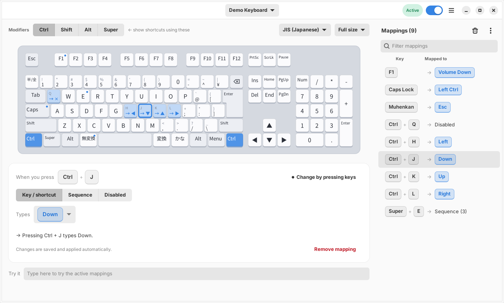

# Keyboard Remapper

[日本語](README.ja.md) · version 1.0.0 · [changelog](CHANGELOG.md)

A keyboard remapper for Linux with a modern GTK4 + libadwaita GUI.
It draws your connected keyboard like the real thing: **click a key (or just press it), choose what it
should type**, and review or change the mapping of any key or combination such as `Ctrl + J`.



## Features

- **No stall on modifier + key combos.** input-remapper 2 emits remapped keys and pass-through keys from
  two different virtual devices. Every modifier → key hand-over (in either order) switches the input
  source, the desktop re-reads the keymap and re-registers *all* global shortcuts, and typing freezes for
  a moment. Keyboard Remapper sends **all output through a single virtual keyboard created once at startup**, so
  the source never switches (covered by automated tests).
- ANSI / ISO / **JIS** layouts, full-size or tenkeyless. Japanese keys (Zenkaku/Hankaku, Muhenkan, Henkan, Kana) included.
- **Apple keyboards (Magic Keyboard etc.)**: Apple layouts (fn / control / option / command, half-height arrows, Eject) are
  picked automatically, and **Fn works as a layer key** (`Fn + H → ←`). Keys the drawn layout lacks show up in an "Other keys" strip.
- Hold a modifier (or pick Ctrl / Shift / Alt / Super on screen) and every keycap shows what that
  combination does.
- Actions: key / shortcut, key sequence (with pauses), disable.
- "Press to set": record the trigger or the output by pressing real keys. While recording, the daemon
  grabs the keyboard exclusively, so keys the desktop normally eats (Super, Alt+F4 …) are captured reliably.
- **Mapping list**: drag rows to reorder, or click a column header (Key / Mapped to) to sort ascending → descending → manual order.
  Right-click a row to remove it instantly (no confirmation; an Undo toast follows), or use the trash button to clear everything.
  Mappings can be **exported to / imported from a file** (menu next to the list) to share them or move to another machine.
- Changes are saved and applied instantly. Deleting can be undone. Light / dark theme, English / Japanese,
  works in narrow windows.

## Install

Requires GTK 4 (≥ 4.6), libadwaita ≥ 1.0 and Python ≥ 3.10 — i.e. **Ubuntu 22.04** or newer, Debian 12, Fedora 36+. Debian / Ubuntu example:

```sh
sudo apt install python3 python3-evdev python3-gi python3-gi-cairo gir1.2-gtk-4.0 gir1.2-adw-1
sudo ./install.sh                      # installs to /usr/local
sudo systemctl enable --now keyboard-remapperd
keyboard-remapper                           # or "Keyboard Remapper" in the application menu
```

`keyboard-remapper-ctl doctor` checks your setup (including that the running service matches the installed version; after an
upgrade run `sudo systemctl restart keyboard-remapperd`). `keyboard-remapper --version` prints the version. Uninstall with `sudo ./uninstall.sh`.

### Upgrading from "Remapper"

This project was called *Remapper* before. `sudo ./install.sh` removes the old service, commands and files
(`remapper-daemon`, `remapper-gtk`, `remapper-control`), and your mappings are carried over automatically
(`~/.config/remapper` → `~/.config/keyboard-remapper`, `/var/lib/remapper` → `/var/lib/keyboard-remapper`).
Then run `sudo systemctl enable --now keyboard-remapperd`.

## How it works

```
GUI (keyboard-remapper, user)  ──JSON over Unix socket──▶  keyboard-remapperd (root, systemd)
  ~/.config/keyboard-remapper/config.json                        ├ grabs keyboards (EVIOCGRAB)
                                                         ├ Engine: input → output translation
                                                         └ ONE virtual keyboard (uinput)
```

- The GUI stores mappings in `~/.config/keyboard-remapper/config.json` and sends them to the daemon. The daemon
  keeps its own copy in `/var/lib/keyboard-remapper/state.json`, so mappings apply after a reboot or replug
  without the GUI.
- Only root and users with an active local login session may use the daemon socket.
- Keys without a mapping pass through with no delay. When a mapping fires, the trigger's modifiers are
  hidden from the output and restored only when a later key actually needs them (hammering
  `Ctrl+J → ↓` produces zero extra Ctrl events). Hiding Super / Alt inserts a harmless key (F24) so the
  desktop does not see a lone Super/Alt tap.
- A combination fires on the last key pressed; the other keys may be pressed in any order.
- A trigger made only of modifiers (e.g. `Left Shift + Left Ctrl → Caps Lock`) fires when the keys are pressed together and
  released with no other key in between, in either order. Ctrl+Shift+T and friends keep working, because the modifiers pass
  through normally until then.
- A key remapped to a single key counts as that key in triggers: with `CapsLock → Ctrl` and
  `Ctrl+J → ↓`, holding CapsLock and pressing J gives ↓.

### Apple keyboard notes

- Linux's `hid-apple` driver reports Fn as a normal key (`KEY_FN`) and translates some Fn combinations itself
  *before* Keyboard Remapper sees them (e.g. Fn+← arrives as Fn + Home, Fn+F1 as F1). Map the keys as they arrive;
  press the key with the window focused to see what it really sends.
- The F-row sends media keys by default; to get F1–F12 without Fn set the kernel option `hid_apple fnmode=2`.
- Bluetooth keyboards are told apart by their address, so two keyboards of the same model are handled separately.

## Troubleshooting: "the output key does nothing"

Check each hop. In a terminal run `keyboard-remapper-ctl monitor --output`, then press the keys:

```
IN   046d:c31c  LEFTCTRL           down      <- the physical key Keyboard Remapper received
OUT              ZENKAKUHANKAKU     down      <- what Keyboard Remapper sent to the desktop
```

- No `OUT` line: the mapping did not fire. Check the trigger in the GUI (left/right modifier, layer).
- `OUT` line present, but nothing happens on the desktop: Keyboard Remapper did its job, the desktop ignored the key.
  Check with `xev -event keyboard` (X11) or `wev` (Wayland): a key that shows `NoSymbol` (no keysym) is ignored.
- **Hankaku/Zenkaku (半角/全角)**: sending `ZENKAKUHANKAKU` normally does nothing - the desktop's key tables (xkb) define no key symbol
  for that key code. xkb treats the Hankaku/Zenkaku key as an alias of the grave key (`<HZTG>` = `<TLDE>`), so on a Japanese (`jp`)
  layout send `GRAVE` instead. (What a *physical* key reports depends on the keyboard: most JIS keyboards report `GRAVE`, some report
  `ZENKAKUHANKAKU` - press the key with Keyboard Remapper's window in front, or use `keyboard-remapper-ctl monitor`, to see yours.) On other layouts, Grave is just a backtick; use a key that exists
  everywhere (`Henkan`, `Muhenkan`, `Hiragana/Katakana`) and bind your input method's on/off to it.

## Commands

```
keyboard-remapper                       the GUI
keyboard-remapperd [--grab-all]       the daemon (--grab-all: route unmapped keyboards through the same virtual device too)
keyboard-remapper-ctl list|apply|stop|start|monitor|doctor
```

## Development

```sh
python3 -m pytest tests --ignore=tests/test_gui.py                      # engine / daemon / IPC
xvfb-run -a dbus-run-session -- python3 -m pytest tests/test_gui.py     # GUI
python3 -m keyboard_remapper.daemon --fake --socket /tmp/r.sock --state /tmp/r.json &   # demo with fake keyboards
python3 -m keyboard_remapper.gui --socket /tmp/r.sock
```

See [docs/DESIGN.md](docs/DESIGN.md) for the design. The UI language follows your locale
(override with `KEYBOARD_REMAPPER_LANG=en` or `ja`).
